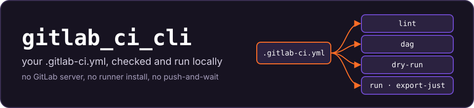
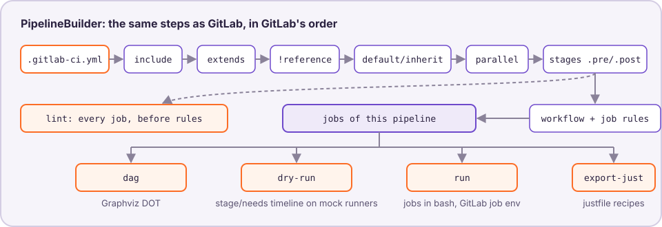

<p align="center"></p>

[](LICENSE) [](Gemfile) [](flake.nix) [](gitlab)

**gitlab_ci_cli lints, draws, simulates and runs your `.gitlab-ci.yml` on your machine**, with GitLab's own rules for building a pipeline. No GitLab server, no runner install, no push-and-wait.

Checking a CI change usually means pushing it and waiting for a pipeline. GitLab's CI Lint needs a server and only simulates the default branch: it does not show which jobs a feature branch, a tag or a merge request gets, or in what order. gitlab_ci_cli answers that locally, in under a second:

- `include`, `extends`, `!reference`, `default:`/`inherit:`, `parallel:matrix`, `.pre`/`.post`, `workflow:` and job `rules:` resolve as in GitLab, ported from its source (pinned in `gitlab/`).
- Pick the pipeline: `--ref feature/x`, `--ref refs/tags/v1`, `--pipeline merge_request_event`. Predefined `CI_*` variables follow, unset where GitLab leaves them unset.
- Run a job in `bash` with the environment GitLab would give it, or export the jobs as `just` recipes.



## Quick start

From a clone of this repository:

```bash
nix run . -- lint --entry examples/quickstart/.gitlab-ci.yml
nix develop        # or work in the dev shell: ./bin/gitlab_ci_cli ...
```

Outside Nix, Ruby 3.3 (what the dev shell provides and the tests run on) runs `./bin/gitlab_ci_cli` directly; Graphviz renders the DAG.

## A first session

[`examples/quickstart/.gitlab-ci.yml`](examples/quickstart/.gitlab-ci.yml) has three stages, a template, a matrix, a `needs: []` job and a deploy rule for `main`. Real output, trimmed at "…":

```console
$ gitlab_ci_cli lint --entry examples/quickstart/.gitlab-ci.yml
GitLab CI configuration is valid
Stages: .pre, build, test, deploy, .post
Jobs: 5
$ gitlab_ci_cli dry-run --entry examples/quickstart/.gitlab-ci.yml --ref main
Pipeline #1 created with 5 job(s)

[T+0s] Job 'build' → Runner 'runner_001'
[T+0s] Job 'lint-docs' → Runner 'runner_001'
[T+5s] Job 'build' completed
[T+5s] Job 'lint-docs' completed
[T+6s] Job 'test: [linux]' → Runner 'runner_001'
[T+6s] Job 'test: [macos]' → Runner 'runner_001'
…
[T+12s] Job 'deploy' → Runner 'runner_001'
[T+17s] Job 'deploy' completed
…
Pipeline status: success
$ gitlab_ci_cli dry-run --entry examples/quickstart/.gitlab-ci.yml --ref feature/login
Pipeline #1 created with 4 job(s)
…
$ gitlab_ci_cli run 'test: [macos]' --entry examples/quickstart/.gitlab-ci.yml
…
Running job: test: [macos]
================================================================================
testing demo on macos

Job 'test: [macos]' succeeded
```

`lint-docs` (`needs: []`) starts at once; the matrix instances wait for the `build` stage; the feature branch gets no `deploy`. `gitlab_ci_cli dag ... | dot -Tsvg` draws the same pipeline. More in [docs/usage.md](docs/usage.md).

## Commands

| Command | Does |
|---|---|
| `lint` | Validates the config and lists every job (`--format text\|json\|junit`). |
| `dag` | Graphviz DOT of the jobs of one pipeline: stages and `needs:` edges. |
| `dry-run` | Schedules the pipeline on a mock runner fleet ([docs/runners.md](docs/runners.md)); exits 1 if it cannot finish. |
| `run <job>` | Runs a job in `bash` on this host, with GitLab's job environment, `after_script` and exit codes. `--run-deps incl` runs what it waits for first. |
| `export-just` | Writes the jobs as `just` recipes doing the same as `run`. |

## Limits

It simulates the pipeline, not the infrastructure. `run` uses no image, services, cache or artifacts. `dry-run` uses mock runners and fixed durations. `spec:inputs` and CI components are not supported yet, and manual or delayed jobs run as normal jobs. Values that only a GitLab instance knows (`CI_PROJECT_ID`, `CI_SERVER_*`, protected refs) are unset unless you pass `--variables`. `run` and exported recipes execute the config's scripts as you: run only configs you trust ([SECURITY.md](SECURITY.md)).

## Documentation

- [Usage](docs/usage.md): every command, predefined variables, parallel jobs, `run`/`export-just`, CLI reference, troubleshooting.
- [Runners](docs/runners.md): the mock fleet format.
- [Architecture](docs/architecture.md): the pipeline steps and where each lives, next to upstream.
- [Development](docs/development.md): `just test`, the `just e2e` golden gate, the GitLab submodule. [Contributing](CONTRIBUTING.md).
- [Changelog](CHANGELOG.md), [Security](SECURITY.md).

## License

Apache-2.0, see [LICENSE](LICENSE).
