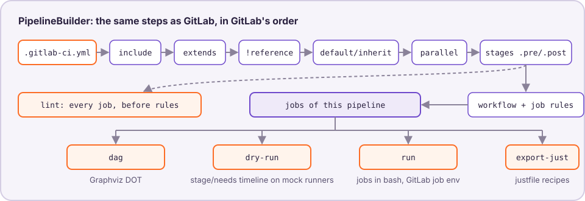

# Architecture

Every command builds the pipeline through one module,
`lib/pipeline_builder.rb`, so lint, dag, dry-run, run and export-just never
disagree about which jobs exist. The steps follow upstream GitLab
(`gitlab/lib/gitlab/ci/config.rb#build_config`, then `Pipeline::Chain`); the
`gitlab/` submodule pins the version the behaviour is checked against
(v19.5.3-ee).

| Step | Here | Upstream |
|---|---|---|
| load YAML (`!reference` kept as a marker) | `lib/ci_yaml.rb` | `Config::Yaml::Loader` |
| `include:` (rules see predefined + CLI vars) | `lib/include_processor.rb` | `Config::External::Processor` |
| `extends:` (every key a root) | `lib/extends_resolver.rb` | `Config::Extendable` |
| `!reference` | `lib/reference_resolver.rb` | `Config::Yaml::Tags::Resolver` |
| nested lists flattened | `PipelineBuilder.flatten_lists` | `Entry` values |
| `default:` / `inherit:` / legacy globals | `PipelineBuilder.compose_jobs` | `Entry::Default`, `Entry::Inherit` |
| `parallel:` / `parallel:matrix` | `lib/parallel_expander.rb` | `Config::Normalizer` |
| stages, `.pre`/`.post`, stage check | `PipelineBuilder.stages`, `stage_errors` | `Config::Stages`, `YamlProcessor` |
| `workflow:rules`, job `rules:` | `lib/rules_evaluator.rb` | `Build::Rules`, `Pipeline::Expression` |

`PipelineBuilder.resolve_config` stops after the stage check: that is what
`lint` validates (every job, whatever the rules). `PipelineBuilder.build`
continues through the rules and returns the jobs of one pipeline, which the
other four commands use. Errors are returned as data in the `Result`, never
printed by the builder.

Around it:

- `lib/predefined_variables.rb`: the `CI_*` variables of the simulated
  pipeline, from `--pipeline`, `--ref` and the git checkout.
- `lib/job_environment.rb`: a job's environment and script phases, shared by
  `run` and `export-just` (GitLab-side expansion, then the runner's).
- `lib/mock_server.rb`, `lib/runner_fleet.rb`, `lib/mock_runner.rb`: the
  dry-run scheduler and the mock fleet ([runners.md](runners.md)).
- `lib/commands/*.rb`: one file per command; `lib/formatters/`: text, JSON
  and JUnit output.
- `lib/ci_keywords.rb`: GitLab's root keys and job keys, checked against the
  submodule by a spec, so a version bump that changes them fails the tests.
