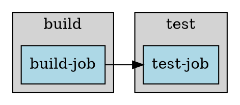

# DAG Command Implementation

## Overview

The `dag` command generates Graphviz DOT format visualizations of GitLab CI pipeline dependency graphs. It transforms YAML pipeline configuration into a visual representation that can be rendered using the `dot` command.

## Design Principles (MPED)

This implementation follows Mark Ruvald Pedersen's architectural principles:

### 1. **Simple Data Transformation**
The DAG command is fundamentally a pure data transformation: `YAML → Internal Structure → DOT Format`
- No side effects (except file I/O)
- No hidden state
- No global variables
- Composable functions that transform data step by step

### 2. **Fail-Fast Error Handling**
All errors are detected early and reported with clear context:
- Missing files: Immediate detection before parsing
- Invalid YAML: Clear syntax error messages from parser
- Circular dependencies: Detected via DFS before output generation
- All errors include descriptive messages for debugging

### 3. **Data Design First**
The implementation prioritizes data structure design:
- Internal pipeline representation separates concerns (stages vs jobs)
- Job dependencies normalized to simple arrays regardless of input format
- DOT generation operates on clean data structures

### 4. **Single Responsibility**
Each method has one clear purpose:
- `read_config_file`: File I/O only
- `parse_yaml`: YAML parsing only
- `build_pipeline_structure`: Data transformation only
- `validate_dag`: Circular dependency detection only
- `generate_dot`: Output formatting only

### 5. **No State Duplication**
- Pipeline structure computed once from config
- DOT output generated on-demand from structure
- No caching of derived state
- Each function computes what it needs from inputs

## Implementation Details

### Architecture

```
┌─────────────────────┐
│  YAML Config File   │
└──────────┬──────────┘
           │
           ▼
    ┌──────────────┐
    │  Read File   │
    └──────┬───────┘
           │
           ▼
    ┌──────────────┐
    │  Parse YAML  │
    └──────┬───────┘
           │
           ▼
┌─────────────────────┐
│ Build Pipeline      │
│ Structure           │
│ - Stages            │
│ - Jobs + needs      │
└──────────┬──────────┘
           │
           ▼
    ┌──────────────┐
    │ Validate DAG │
    │ (DFS cycle   │
    │  detection)  │
    └──────┬───────┘
           │
           ▼
    ┌──────────────┐
    │ Generate DOT │
    │ - Subgraphs  │
    │ - Nodes      │
    │ - Edges      │
    └──────┬───────┘
           │
           ▼
    ┌──────────────┐
    │  DOT Output  │
    └──────────────┘
```

### Data Flow

#### Step 1: Parse YAML
Input:
```yaml
stages:
  - build
  - test

build-job:
  stage: build
  script: ["echo Building"]

test-job:
  stage: test
  needs: [build-job]
  script: ["echo Testing"]
```

Intermediate Structure:
```ruby
{
  stages: ["build", "test"],
  jobs: {
    "build-job" => {
      name: "build-job",
      stage: "build",
      needs: [],
      script: ["echo Building"]
    },
    "test-job" => {
      name: "test-job",
      stage: "test",
      needs: ["build-job"],
      script: ["echo Testing"]
    }
  }
}
```

#### Step 2: Validate DAG
Uses Depth-First Search to detect cycles:
- Track visited nodes
- Track recursion stack
- Back edges indicate cycles

#### Step 3: Generate DOT
Output:


### Error Handling

All error cases are explicitly handled:

1. **File Not Found**
   ```ruby
   raise FileNotFoundError, "Configuration file not found: #{file_path}"
   ```

2. **Invalid YAML**
   ```ruby
   raise InvalidConfigError, "Invalid YAML syntax: #{e.message}"
   ```

3. **Circular Dependencies**
   ```ruby
   raise CircularDependencyError,
         "Circular dependency detected involving job: #{job_name}"
   ```

### Special Cases Handled

1. **Multiple Needs Formats**
   - Simple array: `needs: [job1, job2]`
   - Hash format: `needs: [{job: job1, artifacts: true}]`
   - All normalized to simple string arrays

2. **Missing Stage**
   - Jobs without explicit `stage` default to "test"

3. **Reserved Keywords**
   - Filters out: `stages`, `variables`, `include`, `default`, `workflow`, etc.
   - Only actual job definitions processed

4. **Special Characters**
   - Job names sanitized for DOT format (replace non-alphanumeric with `_`)
   - Labels escaped for proper DOT syntax

## Usage

### Basic Usage
```bash
gitlab_ci_cli dag --entry .gitlab-ci.yml
```

### Generate PNG
```bash
gitlab_ci_cli dag | dot -Tpng -o pipeline.png
```

### Generate SVG
```bash
gitlab_ci_cli dag | dot -Tsvg -o pipeline.svg
```

### Custom Config File
```bash
gitlab_ci_cli dag --entry custom-ci.yml
```

## Testing

Comprehensive test coverage includes:

1. **Valid Configurations**
   - Simple linear pipelines
   - Complex multi-stage pipelines
   - Multiple dependencies per job
   - Hash-format needs

2. **Error Cases**
   - Missing files
   - Invalid YAML syntax
   - Circular dependencies

3. **Edge Cases**
   - Jobs without explicit stage
   - Special characters in job names
   - Empty needs arrays
   - Reserved keyword filtering

Run tests:
```bash
nix-shell --run "bundle exec rspec spec/unit/dag_command_spec.rb"
```

## MPED Design Decisions

### Why Pure Functions?
Each transformation step is a pure function (or as pure as practical in Ruby):
- Easier to test (no setup/teardown)
- Easier to reason about (inputs → outputs)
- Easier to compose (chain transformations)
- No hidden dependencies or state

### Why No Caching?
Following MPED's "minimize state" principle:
- Config is read once (unavoidable I/O)
- Pipeline structure computed once from config
- DOT output generated on-demand
- No premature optimization
- If performance becomes an issue, profile first

### Why Fail-Fast?
All validations happen before output generation:
- File existence checked first
- YAML syntax validated immediately
- DAG cycles detected before DOT generation
- Clear error messages with context
- User knows exactly what's wrong

### Why Explicit Error Types?
Three distinct error classes:
- `FileNotFoundError`: I/O problems (user can fix path)
- `InvalidConfigError`: Syntax problems (user can fix YAML)
- `CircularDependencyError`: Logic problems (user can fix dependencies)
Each has different root causes and solutions

### Why No GitLab Dependencies?
This implementation uses standard Ruby libraries only:
- YAML parsing: built-in Psych
- Graph algorithms: simple DFS implementation
- DOT generation: string building
- No upstream GitLab code needed for pure visualization
- Future: Could integrate GitLab's YamlProcessor if needed

## Future Enhancements

Possible improvements while maintaining MPED principles:

1. **Color Coding**
   - Different colors for different stages
   - Highlight critical path
   - Show job status (if integrated with runner)

2. **Filtering**
   - Show only specific stages
   - Hide certain jobs
   - Focus on subgraph

3. **Annotations**
   - Show job duration estimates
   - Display runner requirements (tags)
   - Include variable dependencies

All enhancements should maintain:
- Pure transformation approach
- Clear error handling
- No hidden state
- Composable design

## References

- PRD Section 3.4.2: DAG Command Specification
- Graphviz DOT Language: https://graphviz.org/doc/info/lang.html
- MPED Principles: Project architectural documentation
